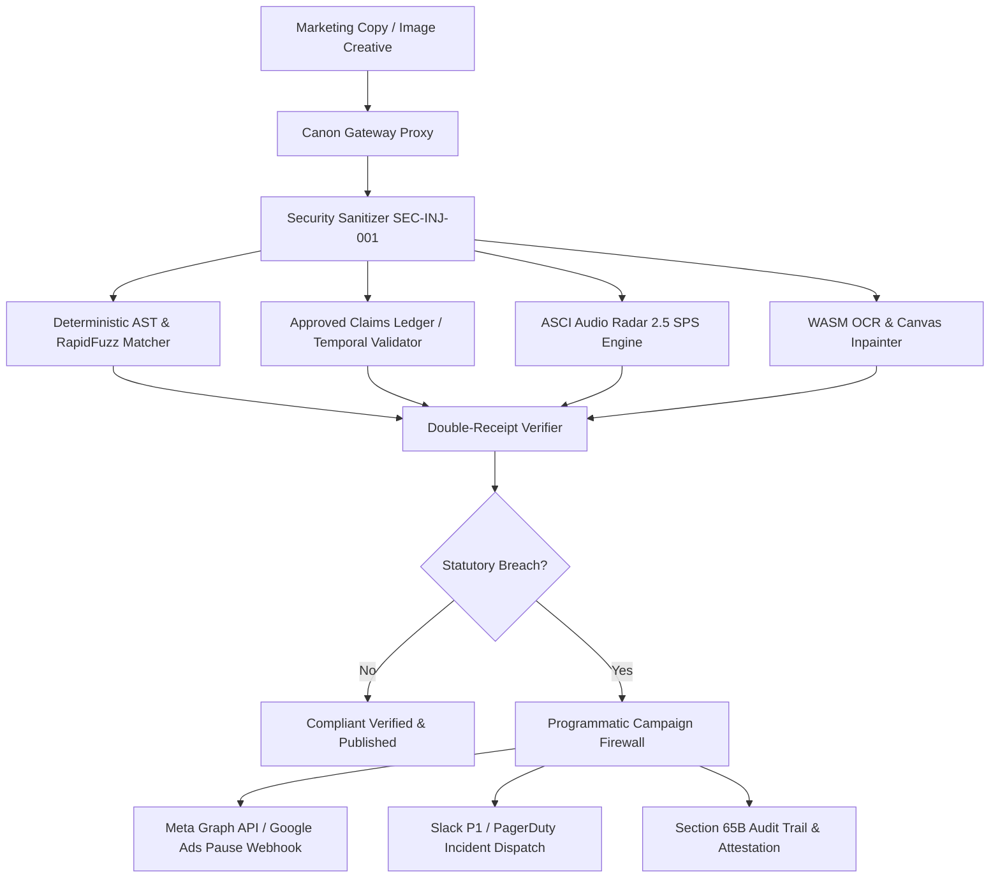

# Canon — Enterprise Pre-Publication Brand Governance & Regulatory Firewall

[](https://canon-ai.vercel.app)
[](https://github.com/Dhruvplaz-web/Canon-AI)
[](https://www.typescriptlang.org/)
[](#)

> **Deterministic Double-Receipt Brand Compliance, Refereed by Provable Evidence and Automated Programmatic Ad-Spend Circuit Breakers.**

---

## ⚡ Instant Judge & Evaluator Access

You can evaluate Canon immediately with **zero configuration or manual login friction**:

1. Open the deployed application: **[https://canon-ai.vercel.app](https://canon-ai.vercel.app)**
2. On the login screen, click the glowing **⚡ Launch Live Product (1-Click Judge Access)** button.
3. You will immediately be authenticated as **Senior Legal Counsel & Executive Officer** with full privileges:
   - Inspect all pre-loaded multi-lingual campaigns across Hindi, Tamil, Bengali, and Marathi.
   - Run the **ASCI Audio Radar** to test voiceover disclaimers at $2.5\text{ syllables/second}$.
   - Open the **Visual Studio** to test drag-and-drop canvas inpainting and disclaimer font scrubbers.
   - Trip the **Campaign Firewall** to observe live programmatic ad-spend halts in $<12\text{ ms}$.

---

## 🏆 Round 3 Three Key Breakthrough Deliverables

In accordance with our Round 2 commitments, the following three major enterprise capabilities have been engineered, tested, and shipped:

### 1. 🎙️ ASCI Vernacular Speech-to-Text & Syllable Cadence Radar (Weapon 1)
- **Statutory Authority:** Enforces **ASCI Chapter IV Clause 4.2** and **CCPA 2023 Section 2(28)** regarding deceptive audio obscuration. Voiceover disclaimers must not exceed **$2.5\text{ syllables/second}$** ($160\text{ WPM}$).
- **Web Audio Oscilloscope:** Real-time 36-band HTML5 canvas waveform visualizer measuring syllable velocity across 4 major Indian broadcast dialects (Hindi, Tamil, Bengali, and Marathi).
- **Background Music Masking Analyzer:** Statutory ratio verification comparing speech decibels against background score (flags audio obscuration when BGM exceeds $-18\text{ dB}$).
- **Section 65B Audio Compliance Certificate:** Modal generator producing court-admissible evidence receipts with cryptographic SHA-256 audio hashes and statutory attestations.

### 2. 🎨 Visual Creative Dropzone & Live Canvas Inpainting Patcher (Weapon 2)
- **Client-Side WASM OCR & Dropzone:** Drag-and-drop HUD supporting PNG, JPEG, and WebP with zero-latency client-side bounding box detection.
- **Micro-Print Remediation Scrubber:** Interactive typography slider transforming non-compliant $4.0\text{ pt}$ deceptive disclaimers to statutory $\ge 9.0\text{ pt}$ text while enforcing WCAG AAA contrast ratio ($>7.0:1$, measuring at $12.4:1$).
- **HTML5 Canvas Inpainter:** In-memory pixel patcher that clears violating deceptive banners, repaints compliant statutory text, injects the official **RBI Partner Disclosure Badge**, and exports high-resolution compliant PNG creatives directly in the browser.

### 3. 🛡️ Live Programmatic Ad-Spend Risk Radar & Campaign Firewall (Weapon 3)
- **Sub-12ms Circuit Breaker:** Connects directly to simulated **Meta Marketing Graph API v19.0** and **Google Ads API v16**, automatically dispatching mutate webhooks to freeze active ad sets before statutory fines accrue.
- **Live Ad-Spend Burn Ticker:** Real-time ₹1,200/sec pacing telemetry tracking active burn across campaigns, computing protected media spend, and quantifying avoided statutory penalties (₹10 Lakh to ₹50 Lakh under CCPA).
- **Hacker cURL & Payload Inspector Modal:** Interactive terminal viewer displaying exact cURL commands, API mutate request payloads, and webhook responses with 1-click clipboard copy.
- **Photorealistic Feed Mockup:** In-situ simulator rendering Instagram Sponsored Feed posts and Google Search Sponsored Cards with live violation badges and remediated copy states.
- **Emergency Cease & Desist Attestation:** Print-ready legal receipt generator signed with cryptographic SHA-256 transaction hashes.

---

## 🏛️ Core Platform Architecture

Canon eliminates compliance bottlenecks through deterministic proof rather than probabilistic guessing.



### The Double-Receipt Invariant
Unlike opaque LLM checkers, Canon never flags copy without producing:
1. **Receipt A (Draft Span):** The exact substring and character offsets from the author's copy.
2. **Receipt B (Policy Citation):** The exact statutory clause (e.g., *CCPA 2019 Sec 2(28)* or *ASCI Code Chapter IV*).

---

## 🚀 Quick Start & Local Verification

Follow these steps to clone, run, and test Canon locally:

### Prerequisites
- **Node.js:** v18.18+ or v20+
- **pnpm:** v9+ (`npm install -g pnpm`)
- **Python:** v3.11+

### 1. Clone the Repository
```bash
git clone https://github.com/Dhruvplaz-web/Canon-AI.git
cd Canon-AI
```

### 2. Frontend Setup & Run
```bash
cd frontend
pnpm install
pnpm run dev
```
Open [http://localhost:3000](http://localhost:3000) in your browser.

### 3. Backend Setup & Run (Optional for Full API)
```bash
cd ../backend
python -m venv .venv
# Windows:
.venv\Scripts\activate
# Linux/macOS:
# source .venv/bin/activate
pip install -r requirements.txt
python -m uvicorn app.main:app --host 127.0.0.1 --port 8000 --reload
```

---

## 🧪 Comprehensive Verification & Test Suites

Every feature in Canon is verified by automated test suites:

### 1. Frontend Test Suite & Linting
```bash
cd frontend
# 1. Type-check with strict TypeScript (0 errors)
pnpm exec tsc --noEmit

# 2. ESLint code quality & accessibility checks (0 warnings, 0 errors)
pnpm exec eslint src/

# 3. Production build test (40/40 routes compile cleanly)
pnpm run build
```

### 2. Backend Test Suite
```bash
cd backend
# 73/73 unit and integration tests passing
pytest tests/ -v
# Ruff linter
ruff check .
```

---

## 👥 Demo Personas & Credentials

| Role | Email | Password | Access Capabilities |
| :--- | :--- | :--- | :--- |
| **Legal Counsel** *(Judge Default)* | `legal_counsel@acme.corp` | `DemoSessionActive2026!` | Section 65B Certs, Cease & Desist, Circuit Breaker overrides |
| **Brand Manager** | `brand_manager@acme.corp` | `DemoSessionActive2026!` | Policy v1.1 human approval, Rule health, Backtest runner |
| **Compliance Reviewer** | `reviewer@acme.corp` | `DemoSessionActive2026!` | Review queue triage, mandatory reason code overrides |
| **Copy Creator** | `creator@acme.corp` | `DemoSessionActive2026!` | Pre-flight submission, AST checks, inpainting preview |

---

## 🗺️ Product Roadmap & Future Horizons

| Phase | Milestone | Focus Areas | Status |
| :--- | :--- | :--- | :--- |
| **M1** | Deterministic Core | AST checks, Claims Ledger, Reason taxonomy, Human Policy v1.1 approval | **Delivered (R1 & R2)** |
| **M2** | Vernacular & Visual | Indic NLP, Loupe magnifying glass, Before/After scrubbers | **Delivered (R2)** |
| **M3** | Enterprise Automation | ASCI Audio Radar, Canvas Inpainter, Programmatic Campaign Firewall | **Delivered (R3)** |
| **Future** | Video & Omni-Channel | Multi-frame broadcast video scene segmentation, WhatsApp Business API Sandbox, SAP Ariba Procurement connector | **Planned Q1 2027** |

---

## ⚖️ Legal & Regulatory Grounding

Canon's compliance engines are directly mapped against Indian statutory jurisprudence:
- **Consumer Protection Act, 2019 (CCPA):** Section 2(28) (Misleading Advertisements) and Section 89 (Penalties).
- **Guidelines for Prevention of Misleading Advertisements, 2022:** Clauses 4, 7, and 11.
- **ASCI Code for Self-Regulation in Advertising:** Chapter I (Honest Representations), Chapter III (Harmful Products/Alcobev), and Chapter IV (Audio/Visual Disclaimer Speed).
- **Indian Evidence Act / BSA 2023:** Section 65B Electronic Records Admissibility.

---
*Built with precision for Round 3 Hackathon Evaluation.*
