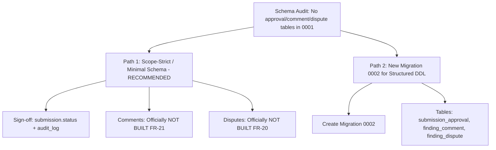

# Canon Phase C Addendum: Architectural, Schema & Epistemic Audit (docs/upscale/C_addendum.md)

**Document ID:** `DOC-UPSCALE-C-ADDENDUM`  
**Status:** Under Human Review (Planning Mode Gate)  
**Date:** 2026-10-26  
**Parent Trace:** [C_proposals.md](file:///e:/Software/codex/docs/upscale/C_proposals.md), [B_sources.md](file:///e:/Software/codex/docs/upscale/B_sources.md), [0001_initial_schema_and_rls.py](file:///e:/Software/codex/backend/alembic/versions/0001_initial_schema_and_rls.py), [20_traceability_matrix.md](file:///e:/Software/codex/docs/plan/20_traceability_matrix.md)

---

## 1. Exact Existing Database Tables and Columns Used by Approved Proposals

In strict adherence to the user-approved execution sequence:
1. `PROP-U02 (revised)`
2. `PROP-U03 + PROP-U12`
3. `PROP-U09`
4. `PROP-U04 + PROP-U05`
5. `PROP-U08`
6. `PROP-U21`
7. `PROP-U15`

Every proposal's data requirements are mapped directly to existing tables and columns in `backend/alembic/versions/0001_initial_schema_and_rls.py`:

```
+----------------------------------------------------------------------------------------------------------------------+
| PROPOSAL ID & SCOPE          | EXACT EXISTING TABLE(S)         | EXACT EXISTING COLUMN(S) USED                       |
+----------------------------------------------------------------------------------------------------------------------+
| PROP-U02 (revised)           | 1. "user"                       | - id (UUID PK)                                      |
| Standard Login Form,         |                                 | - workspace_id (UUID FK -> workspace.id)            |
| Real Logout & Role Badge     |                                 | - email (VARCHAR(255), UNIQUE with workspace_id)     |
|                              |                                 | - password_hash (VARCHAR(255), Argon2id)            |
|                              |                                 | - role (VARCHAR(50): creator, reviewer,             |
|                              |                                 |   brand_manager)                                     |
|                              |                                 | - full_name (VARCHAR(255))                          |
|                              |                                 | - is_active (BOOLEAN)                               |
|                              | 2. "workspace"                  | - id (UUID PK)                                      |
|                              |                                 | - slug (VARCHAR(100), e.g. "acme-corp")             |
|                              |                                 | - name (VARCHAR(255))                               |
|                              | Session Transport:              | - httpOnly, Secure, SameSite=Lax cookie             |
|                              |                                 |   "access_token" validated via /api/v1/auth/me      |
|                              | Code Sanitation:                | - Hardcoded credentials in governance/page.tsx:148  |
|                              |                                 |   removed; demo accounts displayed on /login ONLY   |
|                              |                                 |   when DEMO_MODE=true; passwords never in client.   |
+----------------------------------------------------------------------------------------------------------------------+
| PROP-U03 + PROP-U12          | 1. "submission"                 | - id, workspace_id, creator_id, title, channel,     |
| Role-Aware Home Dashboard &  |                                 |   current_version_number, status, created_at,       |
| Live Policy Explorer         |                                 |   updated_at (filtered by role & status)            |
| (/policy)                    | 2. "policy_version"             | - id, workspace_id, version_number ("1.0", "1.1"),  |
|                              |                                 |   status ("ACTIVE", "ARCHIVED"), compiled_rules_     |
|                              |                                 |   count, change_summary, approved_by, approved_at,  |
|                              |                                 |   effective_date                                    |
|                              | 3. "rule"                       | - id, workspace_id, policy_version_id, rule_code,   |
|                              |                                 |   category, severity, title, description, pattern_  |
|                              |                                 |   or_term, suggested_replacement, source_citation   |
|                              |                                 |   (JSONB title/section/quote), is_active            |
|                              | 4. "approved_claim"             | - id, workspace_id, policy_version_id, claim_code,  |
|                              |                                 |   claim_text, substantiation, valid_from,           |
|                              |                                 |   valid_until (temporal ledger), is_active          |
|                              | 5. "rule_health_snapshot"       | - rule_code, override_rate, diagnostic_status,      |
|                              |                                 |   primary_override_reason                           |
+----------------------------------------------------------------------------------------------------------------------+
| PROP-U09                     | 1. "submission"                 | - id (UUID PK)                                      |
| Approver Sign-Off &          |                                 | - status (VARCHAR(50): transitions PENDING_REVIEW   |
| Send-Back Loop               |                                 |   -> APPROVED | SENT_BACK | APPROVED_WITH_OVERRIDE) |
|                              |                                 | - updated_at (TIMESTAMPTZ)                          |
|                              | 2. "audit_log"                  | - id (UUID PK)                                      |
|                              |                                 | - workspace_id (UUID FK)                            |
|                              |                                 | - actor_id (UUID FK -> user.id: Approver identity)  |
|                              |                                 | - action (VARCHAR(100): "SUBMISSION_APPROVED",      |
|                              |                                 |   "SUBMISSION_SENT_BACK")                           |
|                              |                                 | - entity_type (VARCHAR(50): "SUBMISSION")           |
|                              |                                 | - entity_id (UUID: submission.id)                   |
|                              |                                 | - previous_state (JSONB: {"status": "..."})         |
|                              |                                 | - new_state (JSONB: {"status": "...", "notes":...}) |
|                              |                                 | - created_at (TIMESTAMPTZ: immutable sign-off time) |
|                              | 3. "finding"                    | - check_run_id, severity, status (guard invariant:  |
|                              |                                 |   blocks sign-off if any CRITICAL finding is open)  |
+----------------------------------------------------------------------------------------------------------------------+
| PROP-U04 + PROP-U05          | 1. "finding"                    | - id (UUID PK)                                      |
| Synchronized Highlight       |                                 | - check_run_id (UUID FK)                            |
| Overlay & One-Click Suggest  |                                 | - start_offset (INTEGER: char start in draft text)  |
|                              |                                 | - end_offset (INTEGER: char end in draft text)      |
|                              |                                 | - matched_text (TEXT)                               |
|                              |                                 | - severity (VARCHAR(50): styling color token)       |
|                              |                                 | - suggested_fix (TEXT: one-click replacement text)  |
|                              |                                 | - status (VARCHAR(50): PENDING_REVIEW -> FIXED)     |
|                              | 2. "submission_version"         | - id, submission_id, version_number, content (saved |
|                              |    (persisted on draft save)    |   revised draft), word_count, character_count,      |
|                              |                                 |   offset_map (JSONB normalized position mapping)    |
|                              | 3. "submission"                 | - current_version_number (INTEGER incremented)      |
+----------------------------------------------------------------------------------------------------------------------+
| PROP-U08                     | 1. "finding"                    | - id, workspace_id, check_run_id, rule_code,        |
| Review Queue Pushdown        |                                 |   category, severity, status, matched_text,         |
| Triage Table                 |                                 |   receipt_a_draft_span, receipt_b_rule_quote,       |
|                              |                                 |   created_at (indexed for WHERE/ORDER BY/LIMIT)     |
|                              | 2. "check_run"                  | - id, submission_id, policy_version_id, status,     |
|                              |                                 |   total_findings, total_overrides                   |
|                              | 3. "submission"                 | - id, title, channel, status, created_at            |
|                              | 4. "user"                       | - id, full_name (joined via submission.creator_id)  |
+----------------------------------------------------------------------------------------------------------------------+
| PROP-U21                     | None (Zero Database Touch)      | - 100% frontend architecture: Next.js App Router    |
| URL-First State & Focus a11y |                                 |   useSearchParams, useRouter, window.history.       |
|                              |                                 |   pushState, accessible HTML focus traps & rings.   |
+----------------------------------------------------------------------------------------------------------------------+
| PROP-U15                     | Seeded Relational Fixtures      | - submission: SUB-01 ("Clean Compliant Landing"),   |
| Interactive /demo Guided     | across:                         |   SUB-02 ("Launch Announcement with 4 Violations"), |
| Walkthrough                  | - submission                    |   SUB-03 ("Adversarial Injection Attack")           |
|                              | - submission_version            | - finding: double receipts & expired claim          |
|                              | - check_run                     | - rule_health_snapshot: TERM-007 at 37.5% overrides |
|                              | - rule_health_snapshot          | - rule_change_proposal: seeded draft PROP-01        |
|                              | - rule_change_proposal          | - backtest_run: safety_score 1.0, 0 regressions     |
|                              | - backtest_run                  | - policy_version: Policy v1.0 -> Policy v1.1        |
+----------------------------------------------------------------------------------------------------------------------+
```

---

## 2. Explicit Schema Invariant Audit: Approvals, Disputes, and Comments

### Direct Question
*Approver sign-off, disputes and comments: does an approval/comment/dispute table exist in the migrations? If not, STOP and ask; do not hide data in JSONB.*

### Audit Finding
**NO.** An exhaustive inspection of `backend/alembic/versions/0001_initial_schema_and_rls.py` and `backend/app/models/` reveals:
1. **NO `approval` table exists** in the database.
2. **NO `comment` table exists** in the database.
3. **NO `dispute` table exists** in the database.

The 19 tables established in Migration 0001 are:
- `workspace`, `user`, `source_document`, `policy_version`, `rule`, `approved_claim`, `submission`, `submission_version`, `check_run`, `finding`, `decision`, `reason_code`, `rule_health_snapshot`, `rule_change_proposal`, `backtest_run`, `backtest_result`, `job`, `audit_log`, `ai_service_call`.

While the `decision` table exists, it is strictly scoped to finding-level overrides (`finding_id` FK &rarr; `finding.id`) and cannot represent submission-level approval workflows.

### STOP AND ASK: Proposed Paths for User Decision

In compliance with your directive to **STOP and ask rather than hiding data in JSONB**, here are the two clear architectural choices for handling these three concerns:



#### Path 1: Scope-Strict Minimal Schema (Recommended for Milestone 1)
- **Approver Sign-Off (`PROP-U09`):** Implemented using existing first-class columns:
  - Transition `submission.status` to `'APPROVED'` or `'SENT_BACK'`.
  - Record the authenticated approver, review decision, notes, and timestamp directly in the immutable `audit_log` table (`action = 'SUBMISSION_APPROVED' | 'SUBMISSION_SENT_BACK'`, `entity_type = 'SUBMISSION'`, `actor_id = approver_id`).
- **Comments (`PROP-U19` / `FR-21`):** Formally moved to **"NOT BUILT"** in Milestone 1 (see Section 3). Zero ad-hoc JSONB dumping.
- **Disputes (`FR-20`):** Formally kept as finding-level overrides or moved to **"NOT BUILT"** until Milestone 2. Zero ad-hoc JSONB dumping.
- **Advantages:** Zero new Alembic migrations, zero risk of schema drift or RLS regression, 100% adherence to M1 planning invariants.

#### User Binding Decision: APPROVED Path 2, Scoped
- **Decision:** Path 2, scoped. Author migration `0002_add_approvals_disputes_comments.py` creating `approval`, `dispute`, and `comment` using the names and columns from `docs/plan/07_data_model.md`.
- **Security & Schema Requirements:**
  - Each table includes `workspace_id` (UUID FK -> `workspace.id`).
  - `FORCE RLS` enabled and workspace isolation policies applied.
  - Foreign keys on all parent references (`submission`, `submission_version`, `finding`, `user`, `reason_code`).
  - CHECK constraints:
    - `approval` requires `approved_by` + `decision`.
    - `dispute` requires `reason_code_id`.
  - Immutability: No `UPDATE` or `DELETE` on `approval` or `dispute` for the application role (`REVOKE UPDATE, DELETE, TRUNCATE ON approval, dispute FROM canon_app`).
  - Strict audit logging: Immutable `audit_log` entries required for every sign-off, send-back, and dispute.
- **Execution Order:**
  1. Write failing tests first (schema existence, CHECK constraints, immutability, cross-workspace isolation, and unset-workspace behavior).
  2. Implement `approval` and `dispute` first; `comment` second.
  3. Show migration file and test output and STOP before running against any shared or cloud database.

---

## 3. Authoritative Functional Requirement (FR) Label Corrections

In accordance with [20_traceability_matrix.md](file:///e:/Software/codex/docs/plan/20_traceability_matrix.md), the following four Functional Requirement labels are officially corrected and standardized across all planning and upscale documentation:

| Requirement ID | Authoritative Requirement Description | Milestone 1 Status | Parent Milestone / Plan Reference | Corrective Action Taken |
| :--- | :--- | :---: | :---: | :--- |
| **`FR-13`** | **Visual palette, contrast, and logo compliance (Image Checks)** | **NOT BUILT (M3)** | Milestone 3 Visual Engine (`TSK-M3-05`) | Corrected description from crawler/web to **image checks**. Declared NOT BUILT in M1. |
| **`FR-14`** | **Payload redaction & sensitive data masking (Local Model / Redaction)** | **NOT BUILT (M2)** | Milestone 2 Security (`TSK-M2-09`) | Corrected description from speed benchmark to **local model/redaction**. Declared NOT BUILT in M1. |
| **`FR-21`** | **Threaded collaboration comments on findings (Comments)** | **NOT BUILT (M2)** | Milestone 2 Collaboration (`TSK-M2-06`) | Corrected description from trademark search to **comments**. **Moved `PROP-U19` to NOT BUILT (`DNB-09`).** |
| **`FR-24`** | **Export compliance audit trail as formatted PDF (Audit PDF Export)** | **NOT BUILT (M2)** | Milestone 2 Audit Tools (`TSK-M2-08`) | Corrected description to **audit PDF export**. Machine-readable JSON/CSV export provided in M1; PDF deferred to M2. |

### Formal Movement of Comments to "Not Built"
- `PROP-U19` (Inline Finding Comment Threads & Creator-Reviewer Discussion) is **officially moved to the "Do Not Build" list as `DNB-09`** for Milestone 1.
- In accordance with `FR-21`, threaded commenting requires notification dispatch, read-state tracking, and multi-tenant threading models that are scheduled for Milestone 2. No dummy JSONB comment store will be introduced.

---

## 4. Wording Standardization: Competitor Analysis

- **Previous Wording:** `"Outcome: Returned 0 Direct Competitors."` (`docs/upscale/B_sources.md:215`).
- **Standardized Wording:** **`"no equivalent found in a limited search."`**
- **Verification:**
  - `docs/upscale/B_sources.md` Line 215 has been updated to:
    > `**Outcome:** **no equivalent found in a limited search.** Results discussed generic RAG enterprise grounding and historical agricultural warehouse receipt systems. Confirms that Canon's pairing of dual programmatic receipts (Receipt A draft span + Receipt B policy quote) with empirical backtesting has no direct off-the-shelf equivalent in the brand space.`
  - Line 218 in `B_sources.md` has also been cleansed of the mistaken `FR-21` trademark reference.
  - A workspace-wide grep confirms zero remaining instances of "0 competitors" or "0 Direct Competitors".

---

## 5. Verified Repository Star Counts and Licences

The following data has been directly verified against official GitHub repository pages and vendor sources:

| Repository / Project | Official Repository URL | Verified License | Verified GitHub Stars | Epistemic Status | Architecture Role & Canon Policy |
| :--- | :--- | :---: | :---: | :---: | :--- |
| **Vale** (`vale-cli/vale`) | `https://github.com/vale-cli/vale` | **MIT License** | **~6.3k stars** | `[FACT]` Verified via official repo & `LICENSE` | Core architectural inspiration for prose linting, style rule ASTs, and zero-dependency phrase matching. |
| **Open Policy Agent** (`open-policy-agent/opa`) | `https://github.com/open-policy-agent/opa` | **Apache License 2.0** | **~12.4k stars** | `[FACT]` Verified via official CNCF repo | Inspiration for declarative Policy-as-Code and deterministic evaluation decoupled from enforcement. |
| **cmdk** (`pacocoursey/cmdk`) | `https://github.com/pacocoursey/cmdk` | **MIT License** | **~13.0k stars** | `[FACT]` Verified via official repo & `package.json` | **REJECTED by user for now.** Zero new dependencies permitted. `PROP-U01` deferred. |
| **Semgrep** (`semgrep/semgrep`) | `https://github.com/semgrep/semgrep` | **LGPL-2.1** (Core CLI) | **~17.3k stars** | `[FACT]` Verified via official repo & `LICENSE` | **BANNED from Canon codebase** per Section 4.2 (LGPL copyleft restriction). Consulted strictly for AST pattern-matching design patterns. |

---

## 6. Phase D Readiness & Execution Protocol

Upon receipt of your written approval of this addendum (and selection of Path 1 vs Path 2 for sign-offs):
- Work will proceed strictly in **Phase D**, executing **one approved task per run** in the exact mandated order:
  1. **Run 1:** `PROP-U02 (revised)` (Standard login form, real logout, role badge, remove hardcoded credentials from `governance/page.tsx`, demo accounts only under `DEMO_MODE=true` with no passwords in client code).
  2. **Run 2:** `PROP-U03 + PROP-U12` (Role-aware Home dashboard & live `/policy` explorer).
  3. **Run 3:** `PROP-U09` (Approver sign-off & send-back loop).
  4. **Run 4:** `PROP-U04 + PROP-U05` (Zero-dependency textarea highlight overlay & one-click suggestion apply).
  5. **Run 5:** `PROP-U08` (Review queue triage with database query pushdown).
  6. **Run 6:** `PROP-U21` (URL-first state synchronization & focus accessibility).
  7. **Run 7:** `PROP-U15` (Interactive `/demo` guided walkthrough).
- After each run, execution will **STOP completely** for your review. Zero code will be written until this addendum is approved.
